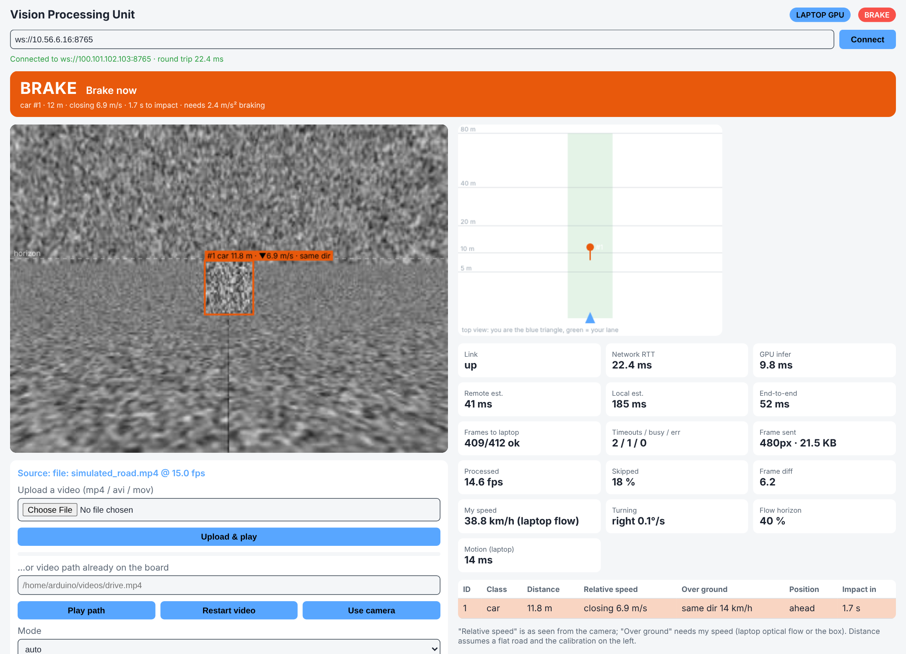
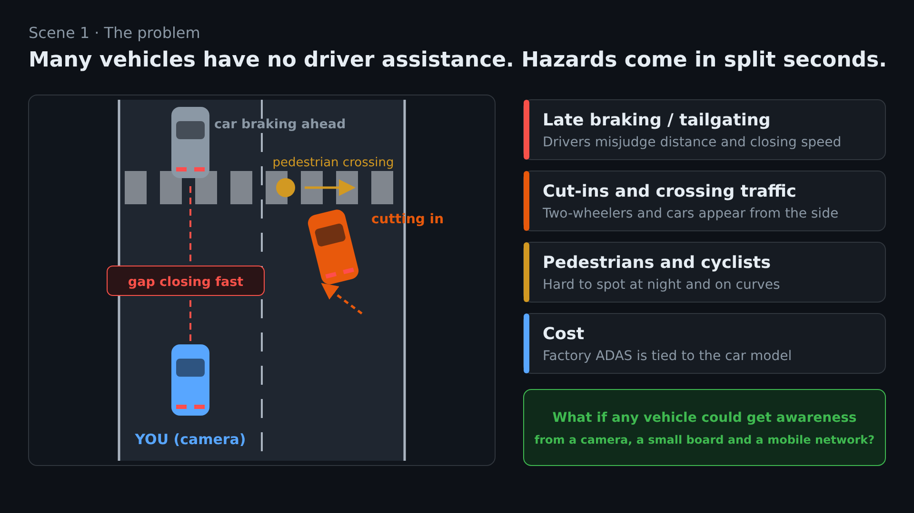
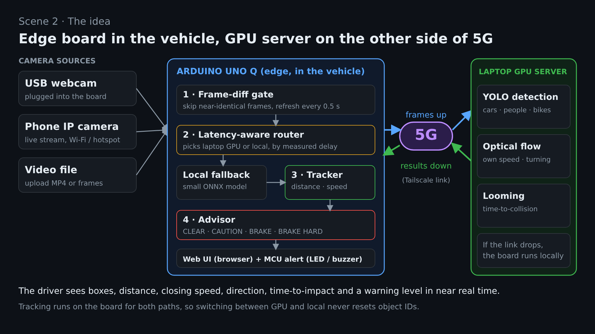
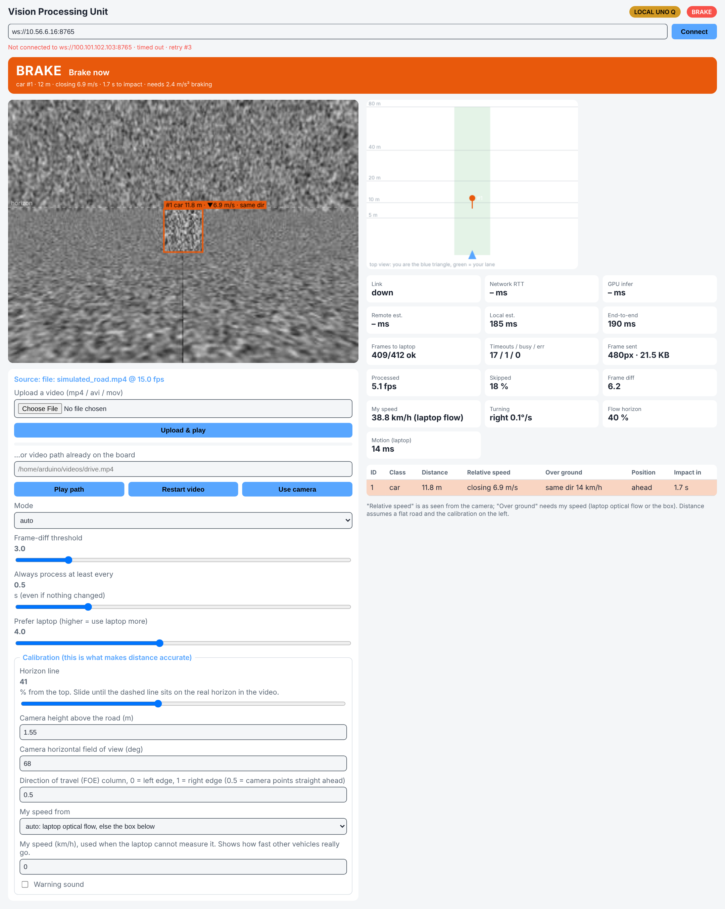

# Latency-aware Vision Processing Unit

Road-scene understanding on a small edge board that borrows a laptop GPU only when the network makes that worthwhile.
An **Arduino UNO Q** (camera, tracking, warnings, web UI) and a **laptop with an NVIDIA GPU** (YOLO + optical-flow
motion analysis) are linked over Wi-Fi / 5G / LAN. A latency-aware router decides, frame by frame, where detection runs,
and falls back to the board itself if the link slows down or drops.


*The board's web UI. Simulated scene (rendered road, see [Verification](#verification-and-limitations)); the UI, tracker, advisor and motion code are the real ones.*

## What it does
- **Detects** cars, buses, trucks, motorcycles, bicycles and pedestrians (YOLOv8).
- **Measures** for every object: distance, closing speed, time-to-collision, lateral position, **direction**
  (same dir / oncoming / crossing L->R / R->L / stopped) and speed over ground.
- **Knows its own motion** from dense optical flow: own speed, turn rate, pitch, dynamic horizon.
- **Warns**: CLEAR / CAUTION / BRAKE / BRAKE HARD banner, optional sound, optional MCU output (LED/buzzer sketch).
- **Adapts to the network**: local vs laptop inference chosen from measured RTT + GPU time; hard timeouts and local fallback.
- **Takes any source**: USB webcam, uploaded video, video path, or a **phone as IP camera** (live).

### Why
A fast-moving vehicle, robot or drone cannot rely on a cloud round trip being fast *every time*. Doing everything on the
edge board is slow; sending everything to a GPU is fragile. This project measures the link continuously and picks the
cheaper path per frame, while tracking and safety logic always stay on the board.



## Architecture


Camera -> **frame-diff gate** -> **router** -> (local ONNX detector **or** laptop GPU over WebSocket) -> **tracker** ->
**advisor** -> web UI / MCU. Details: [docs/how-it-works.md](docs/how-it-works.md), protocol: [docs/protocol.md](docs/protocol.md).

## Repository layout
```
laptop/       GPU server: server.py (YOLO + motion), motion.py (optical flow, ego-motion, looming), self-tests
unoq_app/     Arduino App Lab app: python/ (camera, router, tracker, advisor), assets/ (web UI), sketch/ (MCU)
tools/        frames_to_video, calibrate, replay, export_onnx, quantize_int8, check_link, make_screenshots
docs/         setup, how it works, calibration, test footage + cameras, protocol, images
```

## Quick start
1. **Link the devices** (Tailscale, or a plain LAN with no internet) - [docs/setup.md](docs/setup.md)
2. **Laptop**
   ```bash
   cd laptop
   pip install torch torchvision --index-url https://download.pytorch.org/whl/cu121   # CUDA build
   pip install -r requirements.txt
   python server.py
   ```
3. **UNO Q**: create an App Lab app with the Web UI brick, copy in the contents of `unoq_app/`, put the laptop address
   (`ws://<laptop-ip>:8765`) into the UI box, press **Run**.
4. **Pick a source** in the web page: upload a video, "Play path", or "Use camera" (phone stream URLs work in "Play path").
5. **Calibrate** horizon / camera height / field of view - [docs/calibration.md](docs/calibration.md).

Try it without hardware: `python tools/replay.py clip.mp4 --horizon 0.29 --cam-h 1.55 --hfov 68` writes an annotated video
and a CSV on the laptop alone.

## Web UI tour
| | |
|---|---|
|  | Link lost -> badge turns to **LOCAL UNO Q**, link banner shows the error and retry count, tracking continues without resetting IDs. |

Main areas: link bar, advice banner, video with boxes + horizon, top-view radar, live statistics (RTT, GPU ms, frames sent/ok,
timeouts, own speed, turn rate, flow horizon), track table, and controls for source, mode, gate threshold, calibration.

## Test footage and cameras
- [DriveCache](https://github.com/AdityaGupta2409/DriveCache) frames -> video with `tools/frames_to_video.py`.
- Phone as IP camera (e.g. IP Webcam `http://<phone-ip>:8080/video`).
- Recommended DriveCache calibration: HORIZON 0.29, FOE_X 0.52, CAM_H 1.55 m, HFOV 68 deg.
See [docs/datasets-and-cameras.md](docs/datasets-and-cameras.md).

## Tests
```bash
cd laptop
python selftest_motion.py      # ego speed / TTC on a rendered road with known truth -> PASS
python selftest_tracking.py    # car ahead / stopped / oncoming through motion + tracker -> PASS
```
Observed: ego-speed error about 2 %, looming TTC error about 2.5 %, closing speed settles in 0.4 s (vs 0.8 s from positions only).

## Verification and limitations
Honest status, so nobody is surprised:
- **Verified**: motion/tracking maths on rendered ground-truth scenes and on 4 real DriveCache clips; board code against the real
  server handler with a stubbed detector.
- **Not yet tested**: real YOLO inference end to end, `--flow raft`, `--depth`, a live phone/RTSP stream, and the actual UNO Q /
  GPU laptop / 5G hardware.
- Screenshots in `docs/images/ui_*.png` come from `tools/make_screenshots.py` (simulated scene and placeholder link numbers).
  Replace them with real captures from the board.
- Distance assumes a flat road and a calibrated camera; DriveCache HFOV and camera height are estimates.
- Still photos are not supported as a source (video / streams only).
- DriveCache frames already have YOLO boxes drawn on them.

## Roadmap
- Still-image source, real-hardware benchmarks, INT8 local model on the board, 5G latency measurements.

## Team / course / licence
<!-- TODO: team names, course/competition, supervisor -->
<!-- TODO: choose a licence (e.g. MIT) and add a LICENSE file -->

## Acknowledgements
[DriveCache](https://github.com/AdityaGupta2409/DriveCache) for the test footage; Ultralytics YOLOv8; OpenCV (DIS optical flow).
